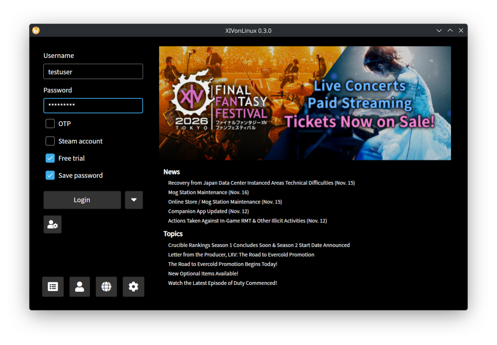

# XIVonLinux

A Linux-native FFXIV launcher targeting the Linux desktop and Steam Deck.

This is very much still a work in progress. It is mostly feature-complete when compared to [XIVLauncher.Core](https://github.com/goatcorp/XIVLauncher.Core), but lacks some polish. It does not use [wine-xiv-git](https://github.com/goatcorp/wine-xiv-git), instead relying on [Umu-launcher](https://github.com/Open-Wine-Components/umu-launcher) and Proton.

## What works
Everything you see in the UI should be functional
* Select a custom proton version, or use one from your steam install. I recommend using ProtonPlus or something similar to manage your proton installs.
* Enable/disable Dalamud, change the injection method, use a custom injector. It also obeys the global lockdown and killswitch used by XIVLauncher and XIVLauncher.Core
* Download the game. Repair the game (only repairs damaged/missing files). Update the game. There's no saving patches yet.
* And obviously, run the game, with or without Dalamud. Steam is supported. The UID cache is also included.

## What's missing
* No auto-login or auto-OTP.
* No launching multiple copies of the game, at least not without using containers or some other exotic tricks.
* No localization.
* Currently it just uses the default Avalonia dark theme.
* No installers yet, just the bare files.
* Not tested on the steam deck or steam machine, or on bazzite gamemode or anything similar.
* It does not currently find your already-downloaded copy of FFXIV. You'll need to point to it manually.

## Warnings for XIVLauncher.Core users
* **DO NOT UPLOAD TSPACKS TO THE XIVLAUCHER DISCORD**
* For the moment, use this github repo for reporting issues and asking for help, or direct message me on discord (RankynBass in the XIVLauncher Discord).
* It does not use `~/.xlcore` for its files. It properly obeys the xdg desktop spec, and uses `~/.config/xivonlinux` for configuration and `~/.local/share/xivonlinux` for data.
* The default download location for FFXIV will be `~/Games/final-fantasy-xiv`.
* The default patches directory is `~/.cache/xivonlinux`.
* You will have to go into settings at least once to select a proton runner, and it does not download one if you don't have any.
* This is beta software. I don't know what might break. It hasn't done anything alarming for me, but who knows? 

## AI Disclaimer
This is written almost exclusively with local AI, specifically [Strata](https://github.com/Niko1221/Strata) with [Swift 1.5 (Qwen3.8)](https://huggingface.co/ukisai/Swift-1.5-Qwen3.8-Flash-Next-GSQ-RCO-GGUF), and using the Hermes agent harness. I have been pretty specific about what I want it to do at each step, and I have read the code, and tweaked some of the axaml directly, but it is otherwise all written with AI.

Why haven't I written any code? I have found, as I worked on this project, that directly editing the code confuses the AI to the point of breaking. This may be a limitation of the local model; I haven't tried any of the frontier models.

## Related projects

- XIVLauncher.Core — reference implementation.
- Dalamud loader (wine-plugin-loader / dalamud loader for Proton).
- umu-launcher (Valve's "Unix Media" launcher wrapper).
